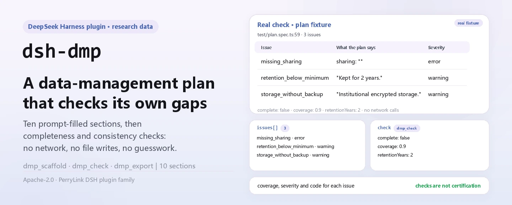
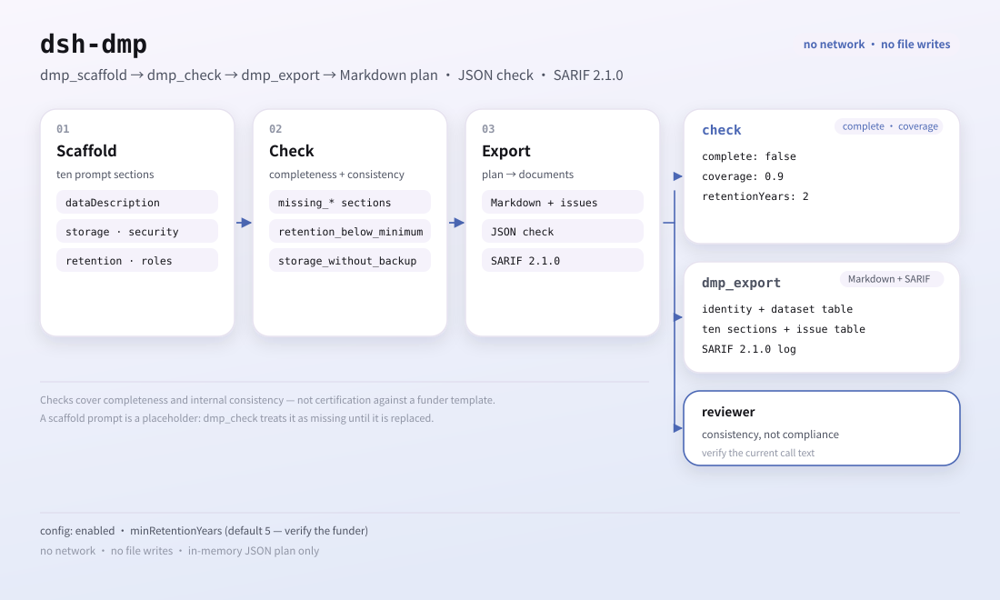
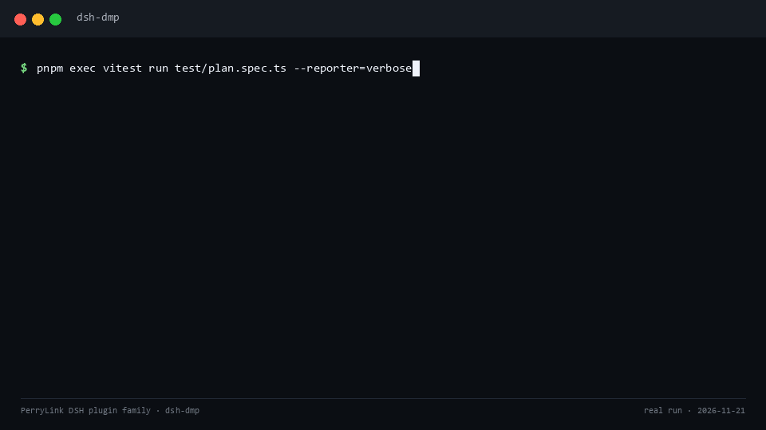

<div align="center">

<picture>
  <source media="(prefers-color-scheme: dark)" srcset="docs/assets/dsh-dmp-hero-en-dark.webp">
  
</picture>

# dsh-dmp

**Un plan de gestión de datos que dice dónde viven los datos, quién puede tocarlos y qué pasa cuando termina la subvención.**

*Andamiaje de diez secciones con indicaciones, comprobaciones de completitud y coherencia (datos personales frente a compartir en abierto, retención mínima, copia de seguridad, repositorio/licencia/DOI), y una exportación Markdown que puedes pegar en el formulario del financiador.*

[English](README.md) · [简体中文](README-zh.md) · [Español](README-es.md) · [Português](README-pt.md) · [हिन्दी](README-hi.md)

[](LICENSE)
[]()

</div>

---

## Qué hace

- **`dmp_scaffold`** — devuelve las diez secciones (descripción de los datos, recogida, documentación, almacenamiento/copia de seguridad, seguridad, compartición, retención, roles, base legal, costes) rellenas con **indicaciones**, no con contenido inventado del proyecto, más entradas opcionales de conjuntos de datos.
- **`dmp_check`** — completitud (10 secciones), cobertura de conjuntos de datos (repositorio, licencia, DOI), coherencia de datos personales (se exigen seguridad y base legal; compartir en abierto sin desidentificación es un error), retención por debajo del mínimo configurado, almacenamiento sin copia de seguridad, contacto ausente.
- **`dmp_export`** — Markdown (identidad, tabla de conjuntos de datos, secciones, tabla de problemas) + comprobación JSON + SARIF 2.1.0.


<picture>
  <source media="(prefers-color-scheme: dark)" srcset="docs/assets/dsh-dmp-flow-v5-dark.svg">
  
</picture>

*Estructura: andamiaje → comprobación → exportación; `check` y el registro SARIF son las dos salidas, y cada problema es una comprobación de completitud/coherencia, no una certificación del financiador. Las etiquetas de token dentro del diagrama son los nombres reales de herramientas y comprobaciones, así que la misma imagen sirve para los cinco idiomas.*

## Qué no hace

- **Sin certificación de la plantilla del financiador.** Las plantillas cambian; las comprobaciones son de completitud y coherencia. Verifica el texto de la convocatoria vigente.
- **Sin asesoramiento jurídico.** «Datos personales» y «compartir en abierto» se juzgan por marcas del plan, no mediante un análisis jurídico.
- **Sin envío al repositorio.** Escribe Markdown; lo envías tú.
- **Sin red, sin escritura de archivos.** Documentos puramente locales.

## Secciones

| Clave | Contenido requerido |
|---|---|
| `dataDescription` | conjuntos de datos, tipos, formatos, volúmenes, marca de datos personales |
| `collection` | proceso de recogida/generación |
| `documentation` | estándar de metadatos, libro de códigos, README |
| `storage` | ubicación del almacenamiento, copia de seguridad, pruebas de restauración |
| `security` | control de acceso, cifrado, dispositivos |
| `sharing` | qué se comparte, cuándo, licencia, repositorio, vía de acceso |
| `retention` | años explícitos y plan de destrucción |
| `roles` | administrador de datos, responsabilidades, contacto |
| `legal` | aprobación ética, consentimiento, acuerdo de tratamiento de datos, transferencias |
| `costs` | costes de almacenamiento/curación y su cobertura |

## Comprobaciones

| Código | Gravedad | Significado |
|---|---|---|
| `missing_*` | warning/error | una sección requerida está vacía o es demasiado corta |
| `no_datasets` | error | no se ha listado ningún conjunto de datos |
| `personal_data_without_security` / `_without_legal` | error | datos personales marcados y la sección correspondiente falta |
| `open_sharing_of_personal_data` | error | se propone compartir en abierto sin desidentificación/acceso restringido |
| `retention_below_minimum` | warning | retención analizada < mínimo configurado (5 años por defecto — verificar) |
| `retention_unparseable` | warning | no se encuentra un periodo explícito |
| `storage_without_backup` | warning | la sección de almacenamiento nunca menciona copia de seguridad/versionado |
| `dataset_without_repository` / `_without_license` | warning | al conjunto de datos le falta repositorio o licencia |
| `dataset_without_persistent_id` | info | sin DOI |
| `no_contact` | warning | sin administrador de datos/contacto |

## Herramientas

### `dmp_scaffold`

`{ title?, funder?, grantId?, institution?, contact?, datasets? }` → `{ ok, plan }`.

### `dmp_check`

`{ plan, minRetentionYears? }` → `{ ok, check: { complete, coverage, issues, retentionYears? } }`.

### `dmp_export`

`{ plan, minRetentionYears? }` → `{ ok, markdown, check, sarif }`.

## Compatibilidad e instalación

| | |
|---|---|
| DeepSeek Harness | **`dsh-v0.2.2-rc.4`** (verificado 2026-11-18); peer `>=0.2.1-0 <0.3.0 \|\| >=0.2.2-0 <0.3.0` |
| Node | `^22.19.0 \|\| >=24.9.0` (probado en `24.22.1`), solo ESM |
| Peers | `@perrylink/dsh-research-core ^0.1.0`, `@deepseek-ai/cordis ^4.0.5-alpha.1`, `@deepseek-ai/dsh-tools`, `@deepseek-ai/schemastery ^3.18.5-alpha.1` |
| Dependencias en tiempo de ejecución | **cero** |

```sh
dsh plugin --profile <name> add @perrylink/dsh-research-core dsh-dmp
dsh --profile <name> --dump-config | grep dsh-dmp
```


> **Nota de peer para toda la familia:** `@perrylink/dsh-research-core` se declara como peer para un contrato de instalación único y uniforme en toda la familia de investigación, aunque este paquete no lo importe en tiempo de ejecución.

## Configuración

| Clave | Predeterminado | Significado |
|---|---|---|
| `enabled` | `true` | `false` no monta nada |
| `minRetentionYears` | `5` | valor predeterminado del andamiaje para la comprobación de retención — **no** es una regla del financiador |

## Límites de seguridad

- Sin red, sin acceso a archivos: el plan es un documento JSON en memoria.
- El plugin no lee ni escribe secretos ni datos personales.

## Evaluación



*Animado: la salida verbose real de `pnpm exec vitest run test/plan.spec.ts` sobre los fixtures del plan (sin red; reejecutado el 2026-11-21). Se omiten las marcas de aprobado porque la fuente del terminal no tiene el glifo de la marca de verificación; los nombres de los casos y las líneas de resumen son literales.*


**15 pruebas**: andamiaje (10 secciones con indicaciones), análisis de retención (años, 年 chino, meses, no analizable), plan completo aceptado, secciones/retención/copia de seguridad ausentes marcadas, conflicto de compartir en abierto datos personales, una publicación en revista que no se confunde con compartir en abierto, andamiajes solo con indicaciones que no cuentan como completos, campos de conjunto de datos/contacto vacíos tratados como ausentes, protecciones ante planes malformados y anulación de retención, esquemas de herramientas, scaffold→check→export de extremo a extremo, ramas de fallo y contrato del paquete.

No se declara ningún benchmark: son comprobaciones estructurales sobre un documento JSON, fijadas por fixtures.

## Limitaciones conocidas (v0.1)

- Las comprobaciones confían en las marcas del propio plan (`containsPersonalData`, redacción sobre compartir); no pueden verificar la realidad.
- Solo palabras clave en inglés/chino para compartir en abierto y desidentificación.
- Sin plantillas específicas de financiadores, sin exportación a DOCX/PDF.
- El mínimo de retención es un valor predeterminado del andamiaje, no una regla del financiador.
- Las indicaciones del andamiaje son marcadores: `dmp_check` las trata como ausentes hasta que se sustituyen por texto del proyecto.

## Licencia

Apache-2.0. Ningún código de terceros en tiempo de ejecución.
