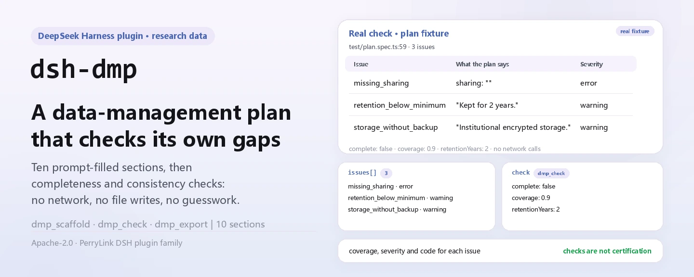
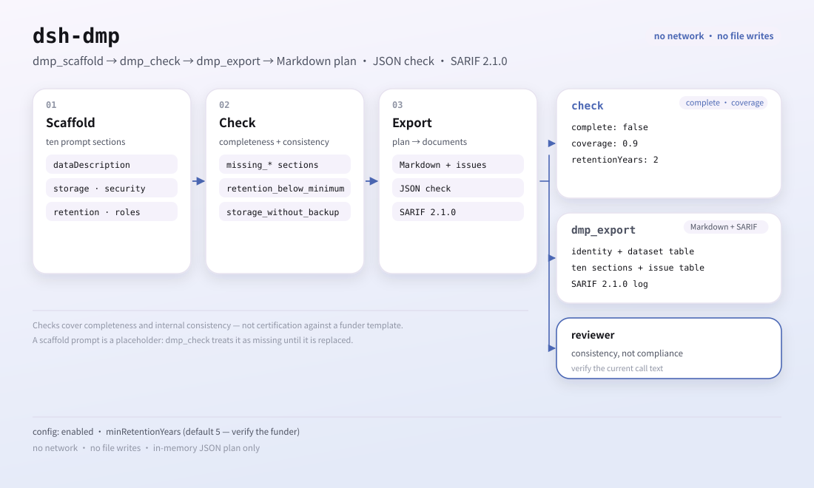
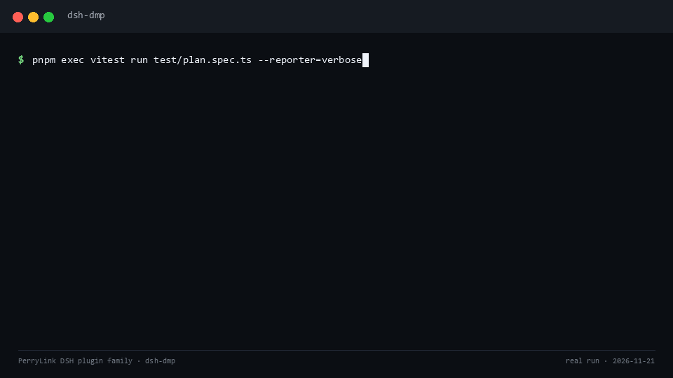

<div align="center">

<picture>
  <source media="(prefers-color-scheme: dark)" srcset="docs/assets/dsh-dmp-hero-en-dark.webp">
  
</picture>

# dsh-dmp

**एक डेटा-प्रबंधन योजना जो बताती है कि डेटा कहाँ रहता है, उसे कौन छू सकता है, और अनुदान समाप्त होने के बाद क्या होता है।**

*दस खंडों वाला scaffold जिसमें prompts हैं, पूर्णता और संगति की जाँचें (व्यक्तिगत डेटा बनाम खुला साझाकरण, न्यूनतम retention, backup, repository/licence/DOI), और एक Markdown निर्यात जिसे आप funder के फ़ॉर्म में चिपका सकते हैं।*

[English](README.md) · [简体中文](README-zh.md) · [Español](README-es.md) · [Português](README-pt.md) · [हिन्दी](README-hi.md)

[](LICENSE)
[]()

</div>

---

## यह क्या करता है

- **`dmp_scaffold`** — दस खंड (डेटा विवरण, संग्रह, प्रलेखन, भंडारण/backup, सुरक्षा, साझाकरण, retention, भूमिकाएँ, कानूनी आधार, लागत) **prompts** से भरे हुए लौटाता है, परियोजना की गढ़ी हुई सामग्री से नहीं, साथ में वैकल्पिक dataset प्रविष्टियाँ।
- **`dmp_check`** — पूर्णता (10 खंड), dataset कवरेज (repository, licence, DOI), व्यक्तिगत-डेटा संगति (सुरक्षा और कानूनी आधार आवश्यक; de-identification के बिना खुला साझाकरण error है), कॉन्फ़िगर किए गए न्यूनतम से नीचे retention, backup के बिना भंडारण, अनुपस्थित संपर्क।
- **`dmp_export`** — Markdown (पहचान, dataset तालिका, खंड, समस्या तालिका) + JSON जाँच + SARIF 2.1.0।


<picture>
  <source media="(prefers-color-scheme: dark)" srcset="docs/assets/dsh-dmp-flow-v5-dark.svg">
  
</picture>

*संरचना: scaffold → जाँच → निर्यात; `check` और SARIF लॉग दो आउटपुट हैं, और हर समस्या पूर्णता/संगति की जाँच है, funder का प्रमाणन नहीं। आरेख के टोकन लेबल असली टूल और जाँच नाम हैं, इसलिए वही चित्र पाँचों भाषाओं के लिए काम करता है।*

## यह क्या नहीं करता

- **funder-टेम्पलेट का प्रमाणन नहीं।** funder के टेम्पलेट बदलते रहते हैं; ये जाँचें पूर्णता/संगति की जाँचें हैं। वर्तमान कॉल का पाठ सत्यापित करें।
- **कानूनी सलाह नहीं।** “व्यक्तिगत डेटा” और “खुला साझाकरण” योजना के संकेतों से आँके जाते हैं, कानूनी विश्लेषण से नहीं।
- **repository में जमा करना नहीं।** यह Markdown लिखता है; जमा आप करते हैं।
- **कोई नेटवर्क नहीं, कोई फ़ाइल लेखन नहीं।** पूरी तरह स्थानीय दस्तावेज़।

## खंड

| कुंजी | आवश्यक सामग्री |
|---|---|
| `dataDescription` | datasets, प्रकार, प्रारूप, मात्रा, व्यक्तिगत-डेटा संकेत |
| `collection` | संग्रह/निर्माण प्रक्रिया |
| `documentation` | मेटाडेटा मानक, codebook, README |
| `storage` | भंडारण स्थान, backup, पुनर्स्थापन परीक्षण |
| `security` | पहुँच नियंत्रण, एन्क्रिप्शन, उपकरण |
| `sharing` | क्या साझा होगा, कब, licence, repository, पहुँच मार्ग |
| `retention` | स्पष्ट वर्ष और विनाश योजना |
| `roles` | डेटा स्टीवर्ड, ज़िम्मेदारियाँ, संपर्क |
| `legal` | नैतिक स्वीकृति, सहमति, DPA, स्थानांतरण |
| `costs` | भंडारण/क्यूरेशन लागत और उसकी कवरेज |

## जाँचें

| कोड | गंभीरता | अर्थ |
|---|---|---|
| `missing_*` | warning/error | कोई आवश्यक खंड खाली या बहुत छोटा है |
| `no_datasets` | error | कोई dataset सूचीबद्ध नहीं |
| `personal_data_without_security` / `_without_legal` | error | व्यक्तिगत डेटा चिह्नित, संबंधित खंड अनुपस्थित |
| `open_sharing_of_personal_data` | error | de-identification/प्रतिबंधित पहुँच के बिना खुला साझाकरण प्रस्तावित |
| `retention_below_minimum` | warning | पढ़ी गई retention < कॉन्फ़िगर किया गया न्यूनतम (डिफ़ॉल्ट 5 वर्ष — सत्यापित करें) |
| `retention_unparseable` | warning | कोई स्पष्ट अवधि नहीं मिली |
| `storage_without_backup` | warning | भंडारण खंड में backup/versioning का कभी उल्लेख नहीं |
| `dataset_without_repository` / `_without_license` | warning | dataset में repository या licence नहीं |
| `dataset_without_persistent_id` | info | कोई DOI नहीं |
| `no_contact` | warning | कोई डेटा स्टीवर्ड/संपर्क नहीं |

## टूल

### `dmp_scaffold`

`{ title?, funder?, grantId?, institution?, contact?, datasets? }` → `{ ok, plan }`.

### `dmp_check`

`{ plan, minRetentionYears? }` → `{ ok, check: { complete, coverage, issues, retentionYears? } }`.

### `dmp_export`

`{ plan, minRetentionYears? }` → `{ ok, markdown, check, sarif }`.

## संगतता और इंस्टॉल

| | |
|---|---|
| DeepSeek Harness | **`dsh-v0.2.2-rc.4`** (2026-11-18 को सत्यापित); peer `>=0.2.1-0 <0.3.0 \|\| >=0.2.2-0 <0.3.0` |
| Node | `^22.19.0 \|\| >=24.9.0` (`24.22.1` पर परखा गया), केवल ESM |
| Peers | `@perrylink/dsh-research-core ^0.1.0`, `@deepseek-ai/cordis ^4.0.5-alpha.1`, `@deepseek-ai/dsh-tools`, `@deepseek-ai/schemastery ^3.18.5-alpha.1` |
| रनटाइम निर्भरताएँ | **शून्य** |

```sh
dsh plugin --profile <name> add @perrylink/dsh-research-core dsh-dmp
dsh --profile <name> --dump-config | grep dsh-dmp
```


> **पूरी family के लिए peer नोट:** `@perrylink/dsh-research-core` को पूरी शोध-परिवार में एक ही, एकरूप इंस्टॉल अनुबंध के लिए peer घोषित किया गया है, भले ही यह पैकेज रनटाइम पर उसे import नहीं करता।

## कॉन्फ़िगरेशन

| कुंजी | डिफ़ॉल्ट | अर्थ |
|---|---|---|
| `enabled` | `true` | `false` होने पर कुछ भी माउंट नहीं होता |
| `minRetentionYears` | `5` | retention जाँच के लिए scaffold डिफ़ॉल्ट — funder का नियम **नहीं** |

## सुरक्षा सीमाएँ

- कोई नेटवर्क नहीं, कोई फ़ाइल पहुँच नहीं: योजना मेमोरी में एक JSON दस्तावेज़ है।
- प्लगइन कोई रहस्य या व्यक्तिगत डेटा न पढ़ता है न लिखता है।

## मूल्यांकन



*एनिमेटेड: plan fixtures पर `pnpm exec vitest run test/plan.spec.ts` का असली verbose आउटपुट (कोई नेटवर्क नहीं; 2026-11-21 को दोबारा चलाया गया)। टर्मिनल फ़ॉन्ट में चेक-मार्क ग्लिफ़ न होने के कारण pass चिह्न हटाए गए हैं; केस नाम और सारांश पंक्तियाँ ज्यों की त्यों हैं।*


**15 परीक्षण**: scaffold (10 prompt खंड), retention पार्सिंग (वर्ष, चीनी 年, महीने, अपार्सेबल), पूर्ण योजना स्वीकृत, अनुपस्थित खंड/retention/backup चिह्नित, व्यक्तिगत डेटा के खुले साझाकरण का टकराव, पत्रिका प्रकाशन को खुला साझाकरण न समझना, केवल-prompt scaffold को अपूर्ण गिनना, खाली dataset फ़ील्ड/संपर्क को अनुपस्थित मानना, विकृत योजना और retention-override गार्ड, टूल स्कीमा, scaffold→check→export end to end, विफलता शाखाएँ, पैकेज अनुबंध।

कोई benchmark का दावा नहीं: ये JSON दस्तावेज़ पर संरचनात्मक जाँचें हैं, fixtures से स्थिर की गईं।

## ज्ञात सीमाएँ (v0.1)

- जाँचें योजना के अपने संकेतों (`containsPersonalData`, साझाकरण की शब्दावली) पर भरोसा करती हैं; वास्तविकता सत्यापित नहीं कर सकतीं।
- खुले साझाकरण और de-identification के लिए केवल अंग्रेज़ी/चीनी संकेत-शब्द।
- funder-विशिष्ट टेम्पलेट नहीं, DOCX/PDF निर्यात नहीं।
- retention न्यूनतम scaffold डिफ़ॉल्ट है, funder का नियम नहीं।
- scaffold prompts प्लेसहोल्डर हैं: परियोजना पाठ से बदले जाने तक `dmp_check` उन्हें अनुपस्थित मानता है।

## लाइसेंस

Apache-2.0. रनटाइम में कोई तृतीय-पक्ष कोड नहीं।
