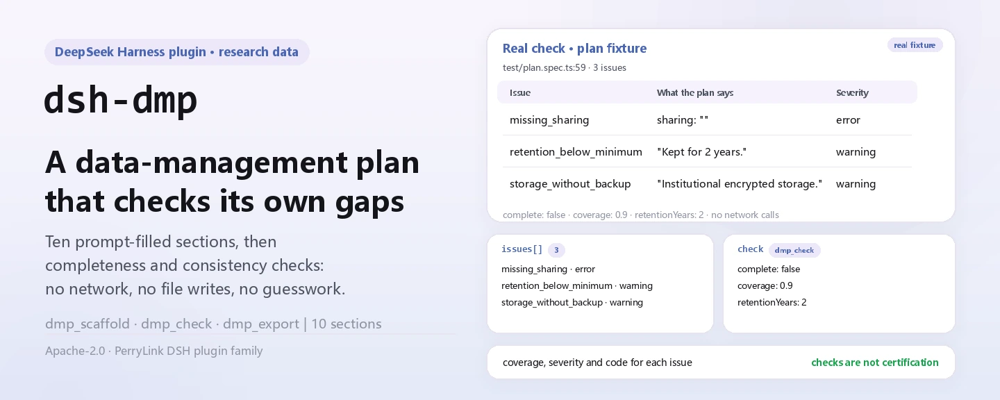
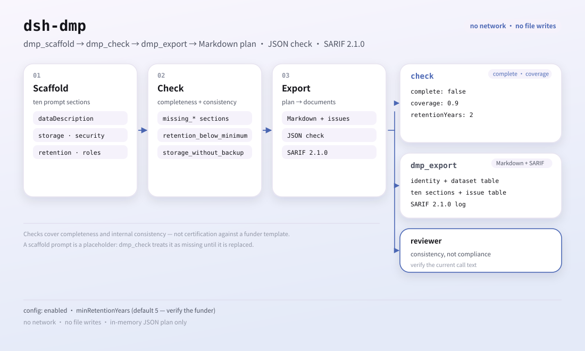
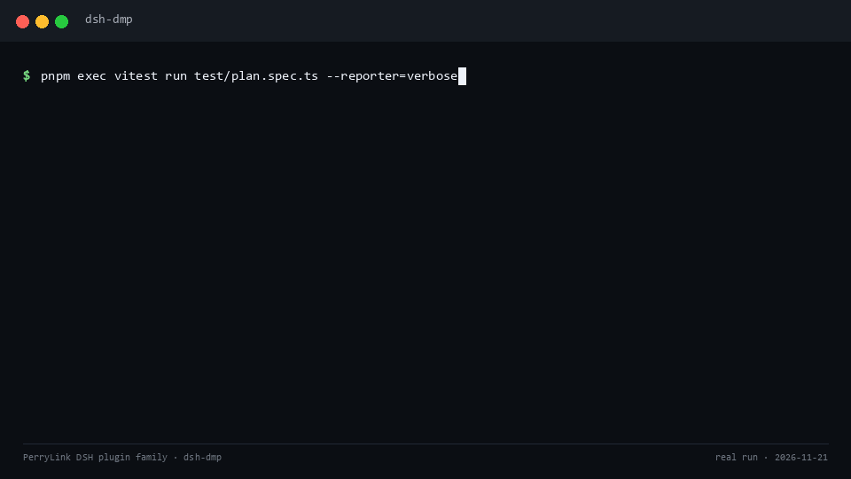

<div align="center">

<picture>
  <source media="(prefers-color-scheme: dark)" srcset="docs/assets/dsh-dmp-hero-en-dark.webp">
  
</picture>

# dsh-dmp

**Um plano de gestão de dados que diz onde os dados vivem, quem pode mexer neles e o que acontece quando o financiamento termina.**

*Estrutura de dez seções com prompts, verificações de completude e consistência (dados pessoais versus compartilhamento aberto, retenção mínima, backup, repositório/licença/DOI) e uma exportação Markdown que você pode colar no formulário do financiador.*

[English](README.md) · [简体中文](README-zh.md) · [Español](README-es.md) · [Português](README-pt.md) · [हिन्दी](README-hi.md)

[](LICENSE)
[]()

</div>

---

## O que faz

- **`dmp_scaffold`** — devolve as dez seções (descrição dos dados, coleta, documentação, armazenamento/backup, segurança, compartilhamento, retenção, papéis, base legal, custos) preenchidas com **prompts**, não com conteúdo inventado do projeto, além de entradas opcionais de conjuntos de dados.
- **`dmp_check`** — completude (10 seções), cobertura de conjuntos de dados (repositório, licença, DOI), consistência de dados pessoais (segurança e base legal obrigatórias; compartilhar em aberto sem desidentificação é erro), retenção abaixo do mínimo configurado, armazenamento sem backup, contato ausente.
- **`dmp_export`** — Markdown (identidade, tabela de conjuntos de dados, seções, tabela de problemas) + verificação JSON + SARIF 2.1.0.


<picture>
  <source media="(prefers-color-scheme: dark)" srcset="docs/assets/dsh-dmp-flow-v5-dark.svg">
  
</picture>

*Estrutura: estrutura → verificação → exportação; `check` e o log SARIF são as duas saídas, e cada problema é uma verificação de completude/consistência, não uma certificação do financiador. Os rótulos de token dentro do diagrama são os nomes reais de ferramentas e verificações, então a mesma imagem serve aos cinco idiomas.*

## O que não faz

- **Sem certificação do modelo do financiador.** Os modelos mudam; as verificações são de completude e consistência. Confira o texto da chamada vigente.
- **Sem consultoria jurídica.** “Dados pessoais” e “compartilhamento aberto” são julgados por sinalizações do plano, não por uma análise jurídica.
- **Sem envio ao repositório.** Ele escreve Markdown; você envia.
- **Sem rede, sem escrita de arquivos.** Documentos puramente locais.

## Seções

| Chave | Conteúdo obrigatório |
|---|---|
| `dataDescription` | conjuntos de dados, tipos, formatos, volumes, sinalização de dados pessoais |
| `collection` | processo de coleta/geração |
| `documentation` | padrão de metadados, livro de códigos, README |
| `storage` | local de armazenamento, backup, testes de restauração |
| `security` | controle de acesso, criptografia, dispositivos |
| `sharing` | o que é compartilhado, quando, licença, repositório, via de acesso |
| `retention` | anos explícitos e plano de destruição |
| `roles` | gestor de dados, responsabilidades, contato |
| `legal` | aprovação ética, consentimento, acordo de tratamento de dados, transferências |
| `costs` | custos de armazenamento/curadoria e sua cobertura |

## Verificações

| Código | Gravidade | Significado |
|---|---|---|
| `missing_*` | warning/error | uma seção obrigatória está vazia ou curta demais |
| `no_datasets` | error | nenhum conjunto de dados listado |
| `personal_data_without_security` / `_without_legal` | error | dados pessoais sinalizados e a seção correspondente ausente |
| `open_sharing_of_personal_data` | error | compartilhamento aberto proposto sem desidentificação/acesso restrito |
| `retention_below_minimum` | warning | retenção analisada < mínimo configurado (5 anos padrão — verifique) |
| `retention_unparseable` | warning | nenhum período explícito encontrado |
| `storage_without_backup` | warning | a seção de armazenamento nunca menciona backup/versionamento |
| `dataset_without_repository` / `_without_license` | warning | o conjunto de dados não tem repositório ou licença |
| `dataset_without_persistent_id` | info | sem DOI |
| `no_contact` | warning | sem gestor de dados/contato |

## Ferramentas

### `dmp_scaffold`

`{ title?, funder?, grantId?, institution?, contact?, datasets? }` → `{ ok, plan }`.

### `dmp_check`

`{ plan, minRetentionYears? }` → `{ ok, check: { complete, coverage, issues, retentionYears? } }`.

### `dmp_export`

`{ plan, minRetentionYears? }` → `{ ok, markdown, check, sarif }`.

## Compatibilidade e instalação

| | |
|---|---|
| DeepSeek Harness | **`dsh-v0.2.2-rc.4`** (verificado em 2026-11-18); peer `>=0.2.1-0 <0.3.0 \|\| >=0.2.2-0 <0.3.0` |
| Node | `^22.19.0 \|\| >=24.9.0` (testado em `24.22.1`), somente ESM |
| Peers | `@perrylink/dsh-research-core ^0.1.0`, `@deepseek-ai/cordis ^4.0.5-alpha.1`, `@deepseek-ai/dsh-tools`, `@deepseek-ai/schemastery ^3.18.5-alpha.1` |
| Dependências em tempo de execução | **zero** |

```sh
dsh plugin --profile <name> add @perrylink/dsh-research-core dsh-dmp
dsh --profile <name> --dump-config | grep dsh-dmp
```


> **Nota de peer para toda a família:** `@perrylink/dsh-research-core` é declarado como peer para um contrato de instalação único e uniforme em toda a família de pesquisa, mesmo que este pacote não o importe em tempo de execução.

## Configuração

| Chave | Padrão | Significado |
|---|---|---|
| `enabled` | `true` | `false` não monta nada |
| `minRetentionYears` | `5` | padrão da estrutura para a verificação de retenção — **não** é uma regra do financiador |

## Limites de segurança

- Sem rede, sem acesso a arquivos: o plano é um documento JSON em memória.
- O plugin não lê nem grava segredos ou dados pessoais.

## Avaliação



*Animado: a saída verbose real de `pnpm exec vitest run test/plan.spec.ts` sobre os fixtures do plano (sem rede; reexecutado em 2026-11-21). As marcas de aprovação foram omitidas porque a fonte do terminal não tem o glifo de check; os nomes dos casos e as linhas de resumo são literais.*


**14 testes**: estrutura (10 seções com prompts), análise de retenção (anos, 年 chinês, meses, não analisável), plano completo aceito, seções/retenção/backup ausentes sinalizados, conflito de compartilhamento aberto de dados pessoais, publicação em periódico que não é confundida com compartilhamento aberto, estruturas só com prompts não contadas como completas, campos de conjunto de dados/contato vazios tratados como ausentes, proteções contra planos malformados e substituição de retenção, esquemas de ferramentas, scaffold→check→export de ponta a ponta, ramos de falha e contrato do pacote.

Nenhum benchmark é reivindicado: são verificações estruturais sobre um documento JSON, fixadas por fixtures.

## Limitações conhecidas (v0.1)

- As verificações confiam nas sinalizações do próprio plano (`containsPersonalData`, redação sobre compartilhamento); não podem verificar a realidade.
- Apenas palavras-chave em inglês/chinês para compartilhamento aberto e desidentificação.
- Sem modelos específicos de financiadores, sem exportação para DOCX/PDF.
- O mínimo de retenção é um padrão da estrutura, não uma regra do financiador.
- Os prompts da estrutura são marcadores: `dmp_check` os trata como ausentes até serem substituídos por texto do projeto.

## Licença

Apache-2.0. Nenhum código de terceiros em tempo de execução.
