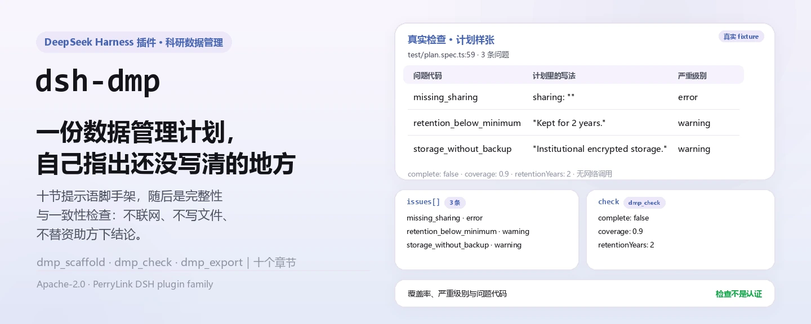
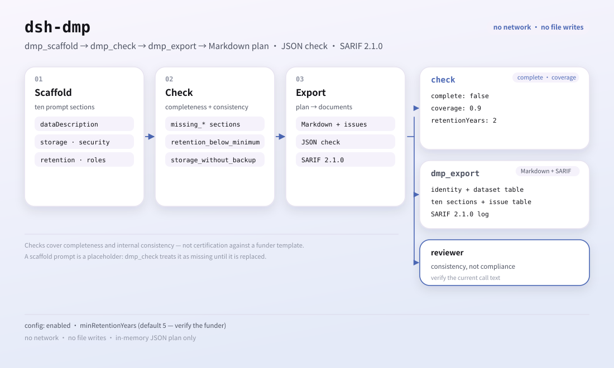
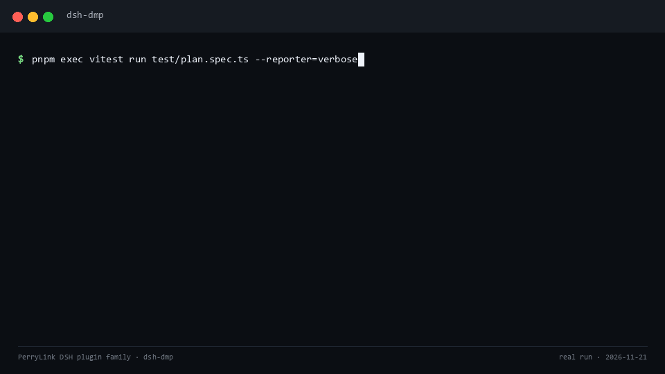

<div align="center">

<picture>
  <source media="(prefers-color-scheme: dark)" srcset="docs/assets/dsh-dmp-hero-zh-dark.webp">
  
</picture>

# dsh-dmp

**一份说得清数据放在哪里、谁能动、资助结束后如何处置的数据管理计划。**

*十节脚手架，每节带提示语；提供完整性与一致性检查（个人数据 vs 开放共享、最短保存期、备份、仓库/许可证/DOI），并导出可粘贴到资助方表格里的 Markdown。*

最近一次核验：DeepSeek Harness `dsh-v0.2.3-alpha.1`（2026-11-22）。

[English](README.md) · [Español](README-es.md) · [Português](README-pt.md) · [हिन्दी](README-hi.md)

[](LICENSE)
[]()

</div>

---

## 它做什么

- **`dmp_scaffold`** — 返回十个章节（数据描述、收集、文档、存储/备份、安全、共享、保存、角色、法律依据、费用），用**提示语**填充，而不是编造项目内容；还可附加数据集条目。
- **`dmp_check`** — 完整性（10 个章节）、数据集覆盖（仓库、许可证、DOI）、个人数据一致性（必须说明安全和法律依据；未去标识化就开放共享是错误）、保存期低于配置下限、有存储但无备份、缺少联系人。
- **`dmp_export`** — Markdown（身份信息、数据集表、章节、问题表）+ JSON 检查结果 + SARIF 2.1.0。

<picture>
  <source media="(prefers-color-scheme: dark)" srcset="docs/assets/dsh-dmp-flow-v5-dark.svg">
  
</picture>

*结构：脚手架 → 检查 → 导出；`check` 与 SARIF 日志是两条输出，每条 issue 都是完整性与一致性发现，而不是资助方认证。图内只有工具名与检查名，五语共用同一张结构图。*

## 它不做什么

- **不提供资助方模板认证。** 资助方模板会变；这些检查是完整性与一致性检查。请核对当前申报指南的原文。
- **不提供法律意见。** “个人数据”和“开放共享”按计划中的标记判断，不做法律分析。
- **不代你提交到数据仓库。** 它只写 Markdown；提交由你完成。
- **不联网、不写文件。** 纯本地文档。

## 章节

| 键 | 必需内容 |
|---|---|
| `dataDescription` | 数据集、类型、格式、体量、个人数据标记 |
| `collection` | 收集/生成过程 |
| `documentation` | 元数据标准、codebook、README |
| `storage` | 存储位置、备份、恢复测试 |
| `security` | 访问控制、加密、设备 |
| `sharing` | 共享什么、何时共享、许可证、仓库、访问途径 |
| `retention` | 明确的年限与销毁计划 |
| `roles` | 数据管理员、职责、联系人 |
| `legal` | 伦理批准、知情同意、DPA、传输 |
| `costs` | 存储/保管成本及其覆盖 |

## 检查项

| 代码 | 严重级别 | 含义 |
|---|---|---|
| `missing_*` | warning/error | 必需章节为空或过短 |
| `no_datasets` | error | 未列出任何数据集 |
| `personal_data_without_security` / `_without_legal` | error | 标记了个人数据，但相应章节缺失 |
| `open_sharing_of_personal_data` | error | 提出开放共享但没有去标识化/限制访问 |
| `retention_below_minimum` | warning | 解析出的保存期 < 配置下限（默认 5 年——请核实） |
| `retention_unparseable` | warning | 未找到明确期限 |
| `storage_without_backup` | warning | 存储章节从未提到备份/版本管理 |
| `dataset_without_repository` / `_without_license` | warning | 数据集缺少仓库或许可证 |
| `dataset_without_persistent_id` | info | 没有 DOI |
| `no_contact` | warning | 没有数据管理员/联系人 |

## 工具

### `dmp_scaffold`

`{ title?, funder?, grantId?, institution?, contact?, datasets? }` → `{ ok, plan }`.

### `dmp_check`

`{ plan, minRetentionYears? }` → `{ ok, check: { complete, coverage, issues, retentionYears? } }`.

### `dmp_export`

`{ plan, minRetentionYears? }` → `{ ok, markdown, check, sarif }`.

## 兼容性与安装

| | |
|---|---|
| DeepSeek Harness | **`dsh-v0.2.2-rc.4`**（2026-11-18 实测）；peer `>=0.2.1-0 <0.3.0 \|\| >=0.2.2-0 <0.3.0` |
| Node | `^22.19.0 \|\| >=24.9.0`（实测 `24.22.1`），仅 ESM |
| Peer 依赖 | `@perrylink/dsh-research-core ^0.1.0`、`@deepseek-ai/cordis ^4.0.5-alpha.1`、`@deepseek-ai/dsh-tools`、`@deepseek-ai/schemastery ^3.18.5-alpha.1` |
| 运行时依赖 | **零** |

```sh
dsh plugin --profile <name> add @perrylink/dsh-research-core dsh-dmp
dsh --profile <name> --dump-config | grep dsh-dmp
```

> **家族统一 peer 说明：** 尽管本包运行时不 import，`@perrylink/dsh-research-core` 仍作为 peer 声明，以保证整个研究插件家族使用同一套安装契约。

## 配置

| 键 | 默认值 | 含义 |
|---|---|---|
| `enabled` | `true` | `false` 时不挂载任何内容 |
| `minRetentionYears` | `5` | 保存期检查的脚手架默认值——**不是**资助方规则 |

## 安全边界

- 不联网、不访问文件：计划是内存中的 JSON 文档。
- 插件不读取也不写入任何机密或个人数据。

## 评测



*动图是 `pnpm exec vitest run test/plan.spec.ts` 的 verbose 真实输出，跑在计划 fixture 上（不联网；2026-11-21 复跑）。终端字体没有对勾字形，因此省去了通过标记；用例名与汇总行均为原样。*

**15 个测试**：脚手架（10 个提示章节）、保存期解析（年、中文“年”、月、无法解析）、完整计划被接受、缺失章节/保存期/备份被标记、个人数据开放共享冲突、期刊论文不被误判为开放共享、只有提示语的脚手架不计为完整、空的数据集字段/联系人视为缺失、畸形计划与保存期覆盖参数的防护、工具 schema、scaffold→check→export 端到端、失败分支、包契约。

不宣称任何基准成绩：这些是对一份 JSON 文档的结构性检查，由 fixture 固定。

## 已知限制（v0.1）

- 检查信任计划自身的标记（`containsPersonalData`、共享措辞）；无法核验现实。
- 开放共享和去标识化只识别英文/中文线索词。
- 没有资助方专属模板，也不导出 DOCX/PDF。
- 保存期下限是脚手架默认值，不是资助方规则。
- 脚手架提示语是占位符：在替换为项目文本之前，`dmp_check` 把它们视为缺失。

## 许可

Apache-2.0。运行时零第三方代码。
