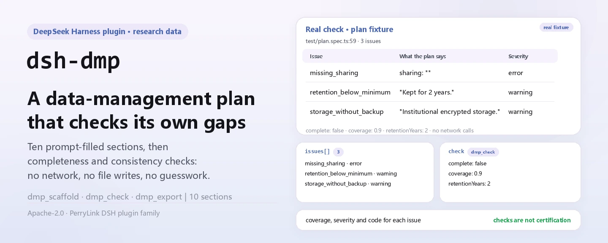
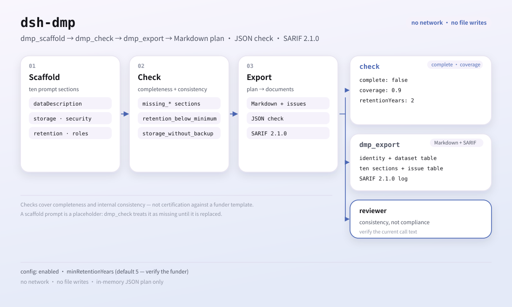
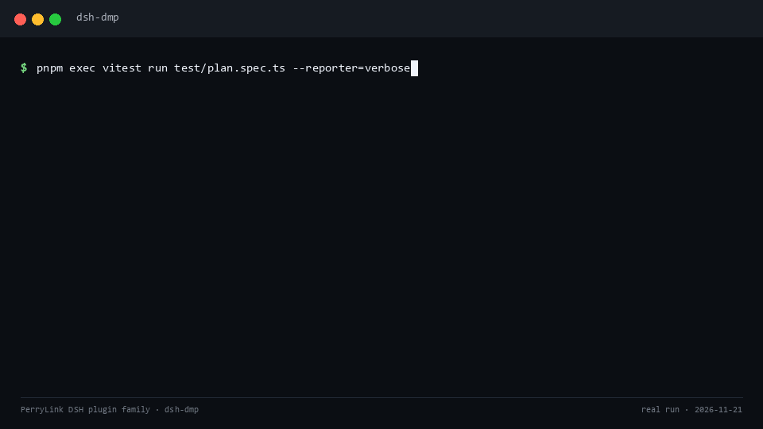

<div align="center">

<picture>
  <source media="(prefers-color-scheme: dark)" srcset="docs/assets/dsh-dmp-hero-en-dark.webp">
  
</picture>

# dsh-dmp

**A data-management plan that says where the data lives, who can touch it, and what happens after the grant ends.**

*Ten-section scaffold with prompts, completeness and consistency checks (personal data vs open sharing, retention minimum, backup, repository/licence/DOI), and a Markdown export you can paste into the funder's form.*

[简体中文](README-zh.md) · [Español](README-es.md) · [Português](README-pt.md) · [हिन्दी](README-hi.md)

[](LICENSE)
[]()

</div>

---

## What it does

- **`dmp_scaffold`** — returns the ten sections (data description, collection, documentation, storage/backup, security, sharing, retention, roles, legal basis, costs) filled with **prompts**, not invented project content, plus optional dataset entries.
- **`dmp_check`** — completeness (10 sections), dataset coverage (repository, licence, DOI), personal-data consistency (security and legal basis required; open sharing without de-identification is an error), retention below the configured minimum, storage without backup, missing contact.
- **`dmp_export`** — Markdown (identity, dataset table, sections, issue table) + JSON check + SARIF 2.1.0.


<picture>
  <source media="(prefers-color-scheme: dark)" srcset="docs/assets/dsh-dmp-flow-v5-dark.svg">
  
</picture>

*Structure: scaffold → check → export; `check` and the SARIF log are the two outputs, and every issue is a completeness/consistency finding rather than funder certification. The token labels inside the diagram are the real tool and check names, so the same picture serves all five languages.*

## What it does not do

- **No funder-template certification.** Funder templates change; the checks are completeness/consistency checks. Verify the current call text.
- **No legal advice.** "Personal data" and "open sharing" are judged by flags in the plan, not by a legal analysis.
- **No repository submission.** It writes Markdown; you submit.
- **No network, no file writes.** Pure local documents.

## Sections

| Key | Required content |
|---|---|
| `dataDescription` | datasets, types, formats, volumes, personal-data flag |
| `collection` | collection/generation process |
| `documentation` | metadata standard, codebook, README |
| `storage` | storage location, backup, restore tests |
| `security` | access control, encryption, devices |
| `sharing` | what is shared, when, licence, repository, access route |
| `retention` | explicit years and destruction plan |
| `roles` | data steward, responsibilities, contact |
| `legal` | ethics approval, consent, DPA, transfers |
| `costs` | storage/curation costs and coverage |

## Checks

| Code | Severity | Meaning |
|---|---|---|
| `missing_*` | warning/error | a required section is empty or too short |
| `no_datasets` | error | no dataset listed |
| `personal_data_without_security` / `_without_legal` | error | personal data flagged, section missing |
| `open_sharing_of_personal_data` | error | open sharing proposed without de-identification/restricted access |
| `retention_below_minimum` | warning | parsed retention < configured minimum (default 5 years — verify) |
| `retention_unparseable` | warning | no explicit period found |
| `storage_without_backup` | warning | storage section never mentions backup/versioning |
| `dataset_without_repository` / `_without_license` | warning | dataset lacks repository or licence |
| `dataset_without_persistent_id` | info | no DOI |
| `no_contact` | warning | no data steward/contact |

## Tools

### `dmp_scaffold`

`{ title?, funder?, grantId?, institution?, contact?, datasets? }` → `{ ok, plan }`.

### `dmp_check`

`{ plan, minRetentionYears? }` → `{ ok, check: { complete, coverage, issues, retentionYears? } }`.

### `dmp_export`

`{ plan, minRetentionYears? }` → `{ ok, markdown, check, sarif }`.

## Compatibility & install

| | |
|---|---|
| DeepSeek Harness | **`dsh-v0.2.2-rc.4`** (verified 2026-11-18); peer `>=0.2.1-0 <0.3.0 \|\| >=0.2.2-0 <0.3.0` |
| Node | `^22.19.0 \|\| >=24.9.0` (tested `24.22.1`), ESM only |
| Peers | `@perrylink/dsh-research-core ^0.1.0`, `@deepseek-ai/cordis ^4.0.5-alpha.1`, `@deepseek-ai/dsh-tools`, `@deepseek-ai/schemastery ^3.18.5-alpha.1` |
| Runtime dependencies | **zero** |

```sh
dsh plugin --profile <name> add @perrylink/dsh-research-core dsh-dmp
dsh --profile <name> --dump-config | grep dsh-dmp
```


> **Family-wide peer note:** `@perrylink/dsh-research-core` is declared as a peer for a single, uniform install contract across the research family, even though this package does not import it at runtime.

## Configuration

| Key | Default | Meaning |
|---|---|---|
| `enabled` | `true` | `false` mounts nothing |
| `minRetentionYears` | `5` | scaffold default for the retention check — **not** a funder rule |

## Security boundaries

- No network, no file access: the plan is an in-memory JSON document.
- No secrets or personal data are read or written by the plugin.

## Evaluation



*Animated: the real verbose `pnpm exec vitest run test/plan.spec.ts` output over the plan fixtures (no network; re-run 2026-11-21). The pass markers are omitted because the terminal font has no check-mark glyph; the case names and the summary lines are verbatim.*


**15 tests**: scaffold (10 prompt sections), retention parsing (years, Chinese 年, months, unparseable), complete plan accepted, missing sections/retention/backup flagged, open-sharing-of-personal-data conflict, a journal publication not mistaken for open sharing, prompt-only scaffolds not counted as complete, empty dataset fields/contact treated as missing, malformed-plan and retention-override guards, tool schemas, scaffold→check→export end to end, failure branches, package contract.

No benchmark is claimed: these are structural checks on a JSON document, pinned by fixtures.

## Known limitations (v0.1)

- The checks trust the plan's own flags (`containsPersonalData`, sharing wording); they cannot verify reality.
- Only English/Chinese cue words for open sharing and de-identification.
- No funder-specific templates, no export to DOCX/PDF.
- Retention minimum is a scaffold default, not a funder rule.
- Scaffold prompts are placeholders: `dmp_check` treats them as missing until replaced with project text.

## License

Apache-2.0. No third-party runtime code.
